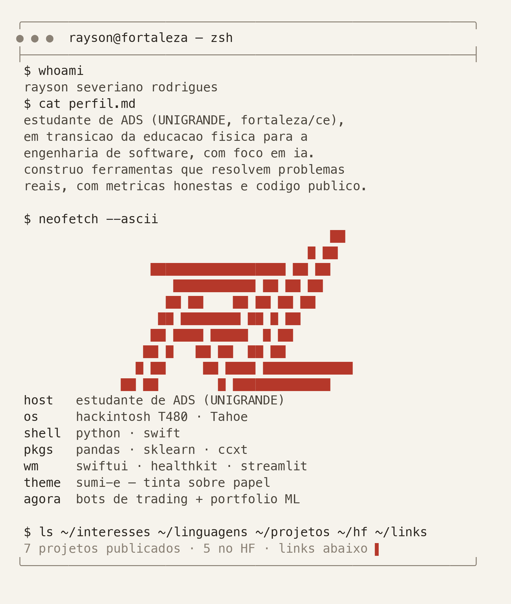

<div align="center">



</div>

```
$ ls ~/interesses/
```

- `├─ ia & llms` — rag · benchmarks pt-br · métricas honestas
- `├─ ios & watchos` — swift · apps 100% no aparelhe · offline
- `├─ dados & automação` — pandas · dashboards · bots
- `├─ cripto & trading` — bots · backtests · funding rates · risco
- `├─ games` — pokémon vgc · bichinhos digitais de pulso
- `├─ hardware` — hackintosh · eletrônica · engenharia reversa
- `└─ corpo & força` — raízes em educação física

```
$ ls ~/linguagens/
```

- `├─ linguagens` — python · swift
- `├─ mobile` — swiftui · watchos · healthkit · widgetkit · vision (ocr) · tts
- `├─ dados & ml` — pandas · scikit-learn · ccxt · sqlalchemy · sqlite
- `├─ automação & devops` — pytest · click · streamlit · git · github actions
- `└─ llms` — openai · groq · ollama

```
$ ls -R ~/projetos/
```

- [`一`] **[nutriscanai](https://github.com/ranzouu/nutriscanai)** `─` swift · vision
  `│` app iOS que lê o rótulo por OCR no aparelhe e soma calorias/macros — 100% offline
- [`二`] **[tameru](https://github.com/ranzouu/tameru)** `─` swift · healthkit
  `│` companheiro digital iPhone/Watch, motor comportamental em Swift puro, 49 testes (adversariais, stress, concorrência)
- [`三`] **[tomawatchi](https://github.com/ranzouu/tomawatchi)** `─` swift · watchos
  `│` bichinho de pulso: passos reais do HealthKit cuidam do pet, 93 espécies, batalha P2P
- [`四`] **[leitorwatch](https://github.com/ranzouu/leitorwatch)** `─` swift · tts
  `│` leitor no Apple Watch em RSVP (uma palavra por vez), livros do iCloud Drive
- [`五`] **[dashboard-vendas-financeiro](https://github.com/ranzouu/dashboard-vendas-financeiro)** `─` python · pandas · aws
  `│` indicadores de vendas e relatórios financeiros
- [`六`] **[pokevgc-cli](https://github.com/ranzouu/pokevgc-cli)** `─` python · cli
  `│` movesets, formatos e stats do cenário VGC direto no terminal

**[LeadForge](https://github.com/ranzouu)** — suíte de IA para prospecção B2B: [rag-lite](https://github.com/ranzouu/leadforge-rag-lite) · [intent-classifier](https://github.com/ranzouu/leadforge-intent-classifier) · [anomaly-detector](https://github.com/ranzouu/leadforge-anomaly-detector) · [prompt-evaluator](https://github.com/ranzouu/leadforge-prompt-evaluator)

```
$ ls ~/hf/
```

[huggingface.co/ranzouu](https://huggingface.co/ranzouu)

- **[leadforge-intent-classifier](https://huggingface.co/ranzouu/leadforge-intent-classifier)** — classificador de intenção de leads, validação cruzada 5-fold honesta (accuracy 0.633 ± 0.192)
- **[anomaly-detection-benchmark](https://huggingface.co/datasets/ranzouu/anomaly-detection-benchmark)** — 12 anomalias injetadas com ground truth por construção; z-score / IQR / STL comparados
- **[retrieval-benchmark-ptbr](https://huggingface.co/datasets/ranzouu/retrieval-benchmark-ptbr)** — 25 queries julgadas em PT-BR, hit@3 0.84, MRR@3 0.79
- **[alimentos-brasileiros-nutricao](https://huggingface.co/datasets/ranzouu/alimentos-brasileiros-nutricao)** — 20 alimentos brasileiros com macros por 100g, extraídos do NutriScan
- **[prompt-evaluator](https://huggingface.co/spaces/ranzouu/prompt-evaluator)** — 3 variantes de prompt comparadas em 36 chamadas reais (gpt-oss-20b via Groq)

```
$ open ~/links/
```

<div align="center">

[ranzouu.github.io](https://ranzouu.github.io) · [github/ranzouu](https://github.com/ranzouu) · [huggingface/ranzouu](https://huggingface.co/ranzouu) · [linkedin](https://www.linkedin.com/in/rayson-severiano-a4a576140/) · [rayson.severiano@gmail.com](mailto:rayson.severiano@gmail.com)

</div>

<div align="center">

<pre>
        /\        /\        /\
   /\  /  \  /\  /  \  /\  /  \  /\
  /  \/    \/  \/    \/  \/    \/  \

        .------.
        |  R   |
        '------'
</pre>

</div>

*feito em fortaleza — tinta sobre papel, hoje num terminal.*